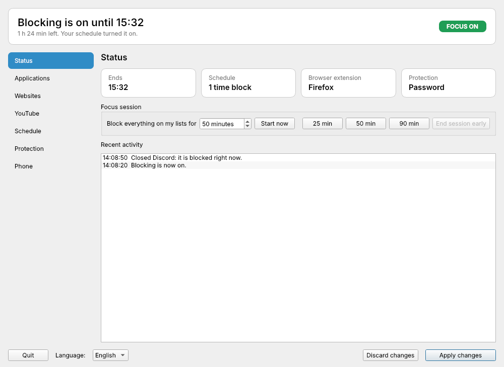
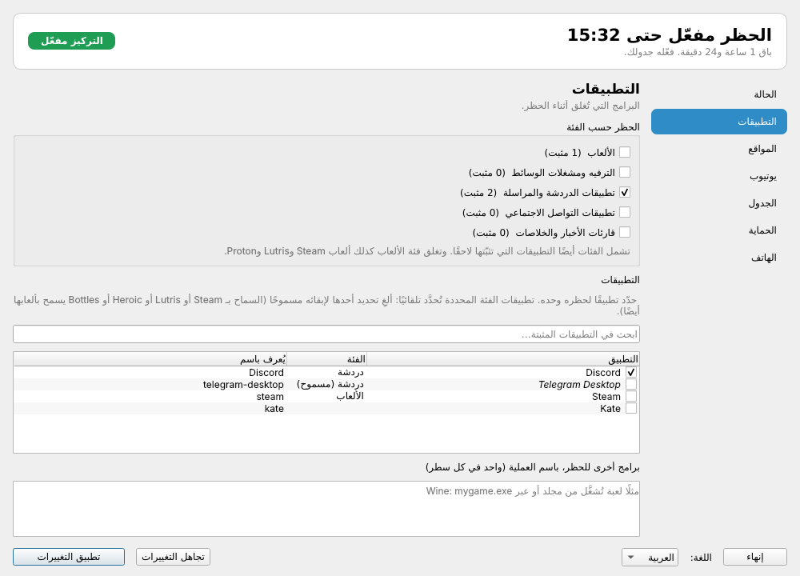

# FocusGuard

A self-control blocker for Linux desktops (built and tested on Kubuntu / KDE Plasma), in the spirit of Freedom and
Cold Turkey, with an optional Android companion app that follows the PC's blocks.

| Folder | What it is | State |
| --- | --- | --- |
| [`pc/`](pc/) | The desktop app: a root service, a settings window with tray icon, a command-line tool and a browser extension | Version 0.3.1, tested on Kubuntu 26.10 |
| [`android/`](android/) | The phone companion app and the PC-to-phone link | **Alpha**: partly tested, expect rough edges |

<p>
  
  
</p>

## Features

### Blocking on the PC

- **Closes blocked applications** within about two seconds of them starting:
  - by category: games, entertainment and media players, chat and messaging apps, social media apps, news and feed readers.
    Categories also cover apps installed later;
  - **exceptions inside a category**: tick a category and untick the one app you still need;
  - any single installed app you tick, or any process name you type (for example a Wine game's `.exe`);
  - recognises native programs, Flatpak and Snap apps, and games started from Steam, Proton, Lutris, Heroic and
    Bottles, including Windows games running under Wine.
- **Blocks websites** for the whole computer through `/etc/hosts`: categories (social media, games, video and
  streaming, news, shopping, gambling and betting), your own list, and sites that must never be blocked.
- **Filters YouTube video by video** with the browser extension: videos play only if their YouTube category is one
  you allow (Education, Science & Technology…). Allow and block keywords are matched against the title, channel and
  tags. Shorts and videos of unknown kind can be blocked too. YouTube can instead be blocked completely or left alone.
- **Browser extension** for Firefox and Chromium-based browsers (Chrome, Chromium, Brave, Edge, Vivaldi, Helium):
  blocks every subdomain, shows a clear "blocked" page, and does the YouTube filtering.

### When it blocks

- **Weekly schedule**: named time blocks by day of the week. A block that ends before it starts runs past midnight.
- **Focus sessions** on demand: 25, 50 or 90 minutes from the window or tray, or any length; sessions can only be
  extended, not shortened, unless you end them with the password.

### Making it hard to switch off

- **Password** (stored as a salted scrypt hash) for changing settings, ending a session early and uninstalling.
- **Strict mode**: during a block nothing can be changed, even with the password, uninstalling is refused and the
  program files are made immutable. Turning it on needs a clear confirmation.
- The service runs as root, restarts within a second if killed, and a watchdog timer restarts and re-enables it if
  it is stopped or disabled. Edits to the hosts file are undone within seconds.
- Optional: close any browser that is not running the extension during a block, and turn off private windows and
  encrypted DNS in Firefox and Chromium-based browsers through browser policies.
- An honest limit: anyone with `sudo` can still remove any blocker. FocusGuard makes that slow and deliberate.

### Everyday use

- **Settings window** that follows your Plasma theme (light or dark), with a status page, recent activity and a
  tray icon showing whether a block is running and notifying when something is closed.
- **English and Arabic** interface, switchable at the bottom of the window; Arabic uses a right-to-left layout.
- **`focusguardctl`** command: status, start or stop a session, set the password, link or unlink a phone.

### Phone link and Android app (alpha)

- The PC publishes its schedule, categories and running sessions, **encrypted with AES-256-GCM**, to the free
  public relay [ntfy.sh](https://ntfy.sh). The topic and key come from a 16-character link code, so the relay
  cannot read anything. Nothing is sent until you link a phone.
- The Android app follows the PC: it closes blocked apps through an accessibility service, blocks websites in every
  app with a local DNS-only VPN, keeps working offline on the schedule, and lets you set each phone app to always
  block, never block or follow the PC.
- This part is **alpha**. It has been tried on a real phone, but not fully. See [android/README.md](android/README.md).

## Install the PC app

On Kubuntu (or another Debian/Ubuntu-based KDE system):

```sh
git clone https://github.com/QuantumPixelNomad/focusguard.git
cd focusguard/pc
sudo ./install.sh
```

Then open **FocusGuard** from the application menu. Adding the browser extension, the full usage guide, how to
uninstall and what has been tested are in [pc/README.md](pc/README.md).

## Tests

```sh
cd pc
python3 -m unittest tests.test_core
sudo python3 -m unittest tests.test_integration
node tests/test_extension.js
```

The Android tests are described in [android/README.md](android/README.md).

## License

[MIT](LICENSE)
